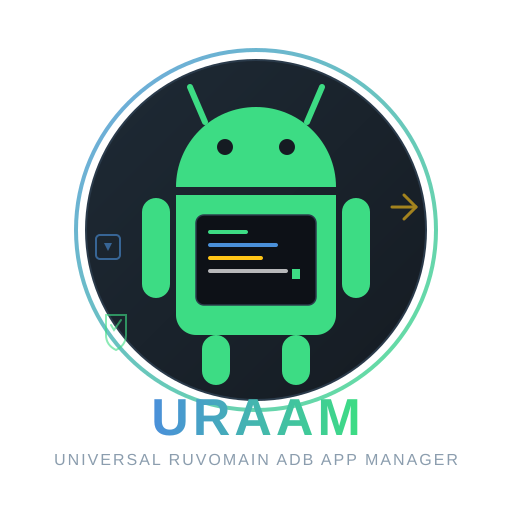

<p align="center">
  
</p>

<h1 align="center">URAAM</h1>
<p align="center"><strong>Universal Ruvomain ADB App Manager</strong></p>
<p align="center">
  <a href="https://github.com/Ruraam/Uraam/actions"></a>
  <a href="https://github.com/Ruraam/Uraam/blob/main/LICENSE.md"></a>
  <a href="https://github.com/Ruraam/Uraam/releases"></a>
  <a href="https://github.com/Ruraam/Uraam/stargazers"></a>
</p>

URAAM is an open-source Bash toolkit for managing Android applications from a terminal. It provides package preview, carefully gated debloating, backup and restoration lists, APK installation, wireless ADB helpers, and support for multiple device-control backends.

It is designed to keep operations visible: URAAM shows the packages it intends to affect, requires explicit confirmation for destructive debloating, and records interrupted operations for manual reconciliation.

> **Important:** Android package changes can remove features or make a device unstable. UAD risk labels and OEM profiles are advisory data, not guarantees. Read the preview, keep a backup, and never remove a package unless you understand its role.

## Contents

- [Features](#features)
- [Supported environments](#supported-environments)
- [Install](#install)
- [Connect an Android device](#connect-an-android-device)
- [Debloat safely](#debloat-safely)
- [Backup and restore](#backup-and-restore)
- [APK installation](#apk-installation)
- [Data locations](#data-locations)
- [Documentation](#documentation)
- [Development and tests](#development-and-tests)
- [Contributing](#contributing)
- [License and acknowledgements](#license-and-acknowledgements)

## Features

- **ADB, local root and Shizuku backends:** use the control method available on the host/device.
- **Preview before action:** compare a selected JSON profile with the packages installed for Android user 0.
- **Manual UAD-NG review:** show package descriptions, categories and risk levels. Each package must be selected explicitly.
- **Fail-closed selection:** URAAM blocks protected, UAD-NG Unsafe, and unknown/unlisted packages in the UAD-NG selection flow.
- **Dry-run:** inspect the exact selected operations without uninstalling or disabling anything.
- **Explicit apply gate:** destructive debloat requires the exact `APPLY N` confirmation.
- **Fresh-state validation:** URAAM refreshes the package inventory and device identity before applying, including again after acquiring the exclusive apply lock.
- **Dependency context:** display UAD-NG dependency and reverse-dependency information when available. This metadata is advisory and incomplete.
- **Interrupted-operation recovery:** a private journal records an operation before it is sent; uncertain operations require human inspection and acknowledgement.
- **Timeouts and transport checks:** bounded device commands and backend health checks prevent a stalled or disconnected session from silently continuing a batch.
- **Backup / restore lists:** save packages missing for Android user 0 and ask Android to re-enable/reinstall existing system package records.
- **Batch APK installation:** install APK files placed in the configured Apps directory.
- **Logs and updater:** inspect operation logs and use the built-in updater where supported.

## Supported environments

| Environment | Device connection / backend | Notes |
|---|---|---|
| Android with Termux | ADB, Shizuku (`rish`), or local root | Termux storage permission may be requested |
| Linux desktop | ADB, local root where configured | Debian/Ubuntu packages and standalone installation are provided |
| WSL | ADB to a reachable Android device | USB passthrough/ADB transport must be configured separately |
| macOS | ADB | Install Android platform-tools and GNU coreutils (`gtimeout`) |
| Other Linux distributions | ADB; root backend where available | Install the required host tools manually if the installer cannot resolve them |

URAAM manages Android **user 0** package state. It does not modify Android system partitions or flash firmware. Backend availability and Android permission behavior vary by device and OS release.

## Install

### Universal installer

Review the installer before running it. Then launch it with Bash:

```bash
bash <(curl -fsSL https://raw.githubusercontent.com/Ruraam/Uraam/main/installer.sh)
```

If curl is unavailable, download `installer.sh` from this repository and run it locally with Bash. The installer detects the environment and offers the available installation path.

### Debian / Ubuntu

Use the latest `.deb` asset from the [GitHub Releases](https://github.com/Ruraam/Uraam/releases) page:

```bash
sudo apt install ./uraam-debian_VERSION_all.deb
```

Replace the filename with the exact asset downloaded. APT resolves declared package dependencies.

### Run from a clone

```bash
git clone https://github.com/Ruraam/Uraam.git
cd Uraam
bash ./uraam.sh
```

Do not run an unreviewed script as root. Use the least-privileged backend that meets your needs.

## Connect an Android device

Choose one connection method:

1. **USB ADB:** enable Developer options and USB debugging, connect the device, accept the authorization prompt, then verify it with `adb devices`.
2. **Wireless debugging:** use Android's Wireless debugging pairing flow or URAAM's wireless helper. Keep the host and device on the same trusted network.
3. **Shizuku:** start Shizuku and make its `rish` command available in the Termux environment before selecting the Shizuku backend.
4. **Local root:** use only on a rooted Android environment where the `su` command is available and authorized.

See the [Quick Start](Docs/Quick-Start-Guide.md) and [Shizuku / Wireless ADB guide](Docs/Shizuku_wireless.md) for detailed setup.

## Debloat safely

1. Connect to the intended device and confirm its identity.
2. Open **Debloat apps** and choose a JSON configuration.
3. Choose **Uninstall for user 0**, **Disable**, or cancel.
4. Review the package inventory classification:
   - selectable UAD-NG candidates: Recommended, Advanced or Expert;
   - blocked: Unsafe and unknown/unlisted UAD-NG entries;
   - protected by URAAM: packages covered by the built-in safety guard;
   - not installed: packages absent from the active user-0 inventory.
5. Select package numbers individually. There is no implicit select-all operation.
6. Review the final package list, OEM/ROM information and any dependency warnings.
7. Choose **Dry-run** to stop without changing package state, or **Apply** to continue.
8. For Apply, type the exact confirmation shown by URAAM, such as `APPLY 2`.

Before the commands are sent, URAAM refreshes the package inventory and rechecks device/OEM/ROM identity. It then acquires an exclusive lock and repeats the critical validation. If the state changed, the operation is aborted.

**Risk labels are not safety guarantees.** A package marked Recommended by UAD-NG may still be required by a particular device, carrier, region, application or firmware feature. OEM profile matches are informational cross-checks, not approval to remove a package.

Read [Debloat safety and recovery](Docs/Safety-and-Recovery.md) and the [UAD-NG catalogue policy](Docs/UAD-NG-review-catalog.md) before applying changes.

## Backup and restore

From the dashboard:

- Choose **Backup restoration list** to save packages that are present in the device package database but are not currently installed for user 0.
- Choose **Restore packages** to pass the selected list to Android using `pm install-existing --user 0`.

This is a restoration list, not a complete device backup. It does not contain APK payloads, app data, settings, photos or firmware. Restoration works only when Android still has the package available on the device; it cannot reinstall an APK that has been completely removed from the package database.

Keep exported JSON files somewhere safe and review their contents before restoring.

## APK installation

Place one or more `.apk` files in the Apps directory shown in the dashboard. Choose **Install APK(s)** and confirm the batch. URAAM reports successful and failed installs; it does not certify the APKs as trustworthy.

Install APKs only from sources you trust.

## Data locations

Paths depend on how URAAM is installed:

| Data | Portable checkout | Installed layout |
|---|---|---|
| Application files | Repository directory | Installation prefix / package-managed paths |
| User debloat profiles | `Configs/debloat/` | `$XDG_CONFIG_HOME/uraam/debloat` or `~/.config/uraam/debloat` |
| APK staging | `Apps/` | `$XDG_DATA_HOME/uraam/Apps` or `~/.local/share/uraam/Apps` |
| Restoration lists | `Configs/backup-restore/` | `$XDG_DATA_HOME/uraam/Configs/backup-restore` |
| Logs and operation journal | `Logs/` | `$XDG_DATA_HOME/uraam/Logs` |

For installed paths, `XDG_DATA_HOME` and `XDG_CONFIG_HOME` are respected when set. The exact active paths are printed in the dashboard.

## Documentation

| Guide | Description |
|---|---|
| [Documentation index](Docs/README.md) | All user, maintainer and contributor guides |
| [Quick Start](Docs/Quick-Start-Guide.md) | Installation, dependencies and first connection |
| [Architecture](Docs/Architecture.md) | Runtime layout, backends, data flow and boundaries |
| [Safety and Recovery](Docs/Safety-and-Recovery.md) | Preview/apply gates, timeout behavior, journal and lock |
| [UAD-NG review catalogue](Docs/UAD-NG-review-catalog.md) | Pinned source, risk labels, dependency data and selection policy |
| [Shizuku and Wireless ADB](Docs/Shizuku_wireless.md) | Pairing and connection setup |
| [Configuration format](Configs/debloat/README.md) | JSON profiles, validation and OEM profile rules |
| [Contributing](Contributing.md) | Code, documentation and profile contributions |

## Development and tests

The repository includes shell-safety, preview/dry-run, interrupted-process and metadata validation tests. On a Debian/Ubuntu development host:

```bash
sudo apt-get update
sudo apt-get install --yes bash jq shellcheck python3
bash -n uraam.sh
shellcheck --severity=error uraam.sh tests/*.sh
python3 tests/validate_uad_metadata.py
bash tests/test-preview-dry-run.sh
bash tests/test-interrupted-process.sh
```

The tests use mocks. They do **not** replace testing with a real Android device, each supported backend, or every host operating system. See the workflow files under `.github/workflows/` for the CI commands.

## Contributing

Issues, reproducible bug reports, documentation improvements and tested configuration profiles are welcome. Please read [Contributing.md](Contributing.md) and the [profile contribution guide](Configs/debloat/README.md) before opening a pull request.

## License and acknowledgements

URAAM is distributed under the [GNU General Public License v3.0](LICENSE.md). The bundled UAD-NG catalogue is separately attributed and includes its upstream GPL-3.0 licence information in `Configs/uad/`.

Package risk metadata is sourced from [Universal Debloater Alliance – Next Generation](https://github.com/Universal-Debloater-Alliance/universal-android-debloater-next-generation). See the pinned source revision in [Configs/uad/source.json](Configs/uad/source.json).

Thanks to the contributors and community members who report issues, test devices and share configuration profiles.
